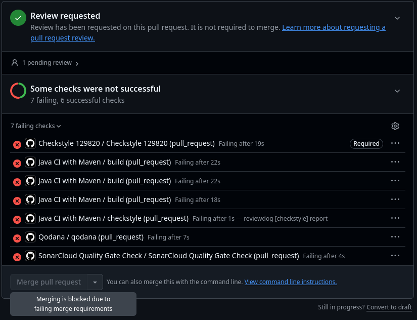

# Checkstyle: 129820 - Dinis

## Regra escolhida
`ConstantName` (constantes), com o padrão `^[A-Z][A-Z0-9]*(_[A-Z0-9]+)*$`.

## Ficheiros
- Configuração: `checkstyle-129820.xml`
- Workflow: `.github/workflows/checkstyle-129820.yaml`

## Execuções do quality gate
- Gate a falhar (violação: maxShips (constante em camelCase)): https://github.com/LEI-129853/Battleship2/actions/runs/42529054019/job/128878949931?pr=26
- Gate a passar (depois de corrigir o nome): https://github.com/LEI-129853/Battleship2/actions/runs/42529464917/job/128880223565?pr=26

## Proteção do ramo `main`
Ruleset `protect-main` no ramo `main`: exige PR e os 6 checks (`Qodana smell gate 129853/129820/129851` e `Checkstyle 129853/129820/129851`).
No PR #26 (https://github.com/LEI-129853/Battleship2/pull/26) o `Checkstyle 129820` falha e o merge fica bloqueado.

## O que o Checkstyle não verifica
O Checkstyle só verifica se o nome segue o padrão (regex) e não se é significativo, se descreve a intenção ou se está bem escolhido; um nome como `abc` ou `calcular2` passa. A regra também só se aplica a este tipo de identificador, por isso nomes de outros tipos (variáveis locais, classes, parâmetros) ficam sem verificação.
