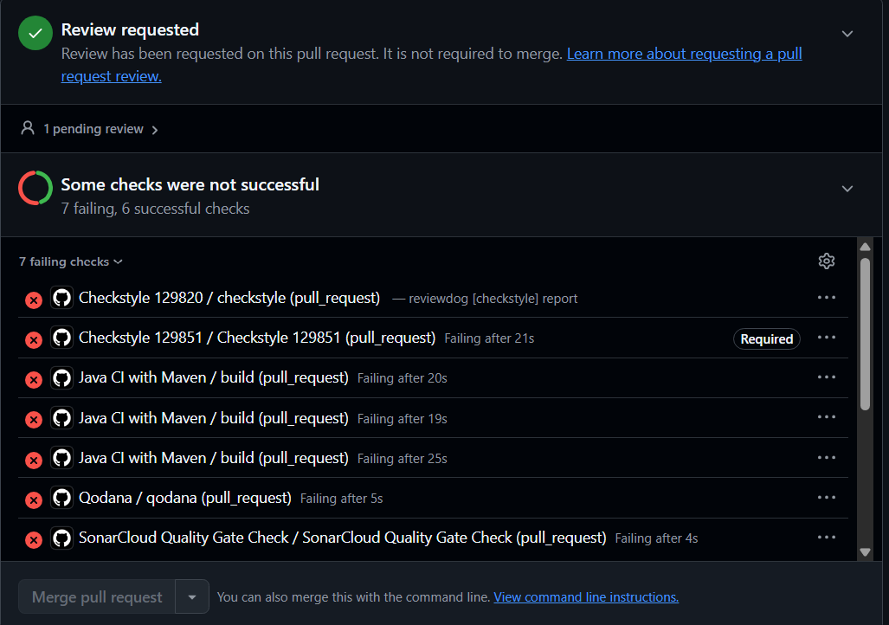

# Checkstyle: 129851 - Duarte

## Regra escolhida
`MemberName` (atributos (membros de instância)), com o padrão `^[a-z][a-zA-Z0-9]*$`.

## Ficheiros
- Configuração: `checkstyle-129851.xml`
- Workflow: `.github/workflows/checkstyle-129851.yaml`

## Execuções do quality gate
- Gate a falhar (violação: Total_Ships (atributo com maiúscula e underscore)): https://github.com/LEI-129853/Battleship2/actions/runs/42529041944/job/128878915375?pr=25
- Gate a passar (depois de corrigir o nome): https://github.com/LEI-129853/Battleship2/actions/runs/42529155774/job/128879262932?pr=25

## Proteção do ramo `main`
Ruleset `protect-main` no ramo `main`: exige PR e os 6 checks (`Qodana smell gate 129853/129820/129851` e `Checkstyle 129853/129820/129851`).
No PR #25 (https://github.com/LEI-129853/Battleship2/pull/25) o `Checkstyle 129851` falha e o merge fica bloqueado.

## O que o Checkstyle não verifica
O Checkstyle só verifica se o nome segue o padrão (regex) e não se é significativo, se descreve a intenção ou se está bem escolhido; um nome como `abc` ou `calcular2` passa. A regra também só se aplica a este tipo de identificador, por isso nomes de outros tipos (variáveis locais, classes, parâmetros) ficam sem verificação.
