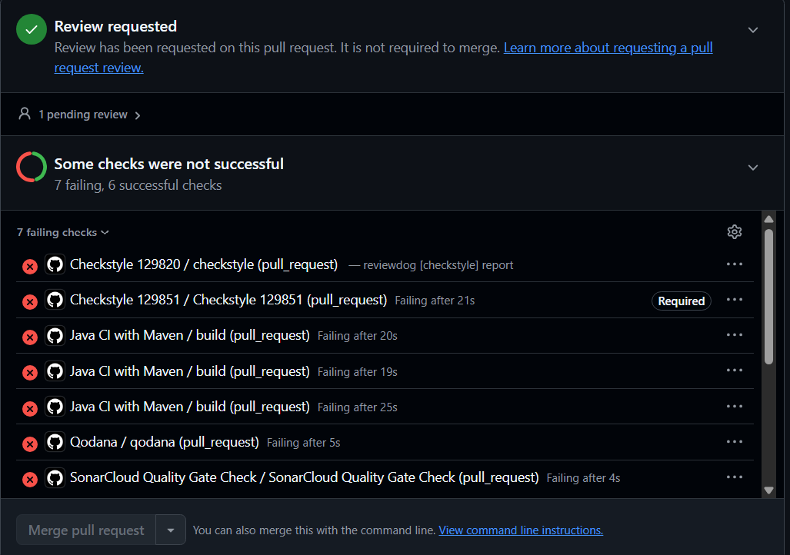

# Qodana: 129851 - Duarte

## Cheiro escolhido
Large Class (God Class no livro *Object-Oriented Metrics in Practice*, p. 80-81).

## Tabela de mapeamento

| Cheiro (Fowler) | Inspeção no IDE | ID da inspeção | Métrica / limiar | Limitações |
|---|---|---|---|---|
| Large Class | Class with too many methods | `MethodCount` | NOM, `m_limit` = 15 (`ignoreGettersAndSetters` = false, `ignoreOverridingMethods` = false) | Sem TCC nem ATFD, ou seja, a coesão não é avaliada |
| Large Class | Overly complex class | `ClassComplexity` | WMC, `m_limit` = 47 | Limiar absoluto, não relativo ao sistema; não é possível exigir as condições em simultâneo (AND) |

## Ficheiros
- Workflow: `.github/workflows/qodana-smell-129851.yaml`
- Configuração: `qodana-129851.yaml`
- Perfil de inspeção: `.qodana/profiles/profile-129851.yaml`

## Execuções do quality gate
- Gate a falhar (cheiro provocado): https://github.com/LEI-129853/Battleship2/actions/runs/42525803343/job/128869025468?pr=22
- Gate a passar (depois de corrigir): https://github.com/LEI-129853/Battleship2/actions/runs/42528129876/job/128876170005?pr=22

## Proteção do ramo `main`
Ruleset `protect-main` no ramo `main`: exige PR e os 6 checks (`Qodana smell gate 129853/129820/129851` e `Checkstyle 129853/129820/129851`).
No PR #25 (https://github.com/LEI-129853/Battleship2/pull/25) o `Checkstyle 129851` falha e o merge fica bloqueado.

## Sensibilidade aos limiares

| Limiar (métodos / complexidade) | `severityThresholds.any` | Nº de problemas | Resultado |
|---|---|---|---|
| 15 / 47 | 0 | 11 | falha |

## Reflexão
O Qodana detetou a classe com mais de 15 métodos (`Class with too many methods`) e o gate falhou; ao reduzir o número de métodos passou. Em `main` a análise completa encontrou 11 problemas (8 classes com demasiados métodos e 3 classes demasiado complexas), por isso os limiares 15 (NOM) e 47 (WMC) apanham classes realmente grandes. Faltam as métricas de coesão e acesso a dados de outras classes (TCC e ATFD) da estratégia God Class do livro, pelo que uma classe grande mas coesa seria falso positivo e uma classe pequena com muito acoplamento passaria despercebida. Os limiares são absolutos e não é possível combiná-los com AND.
