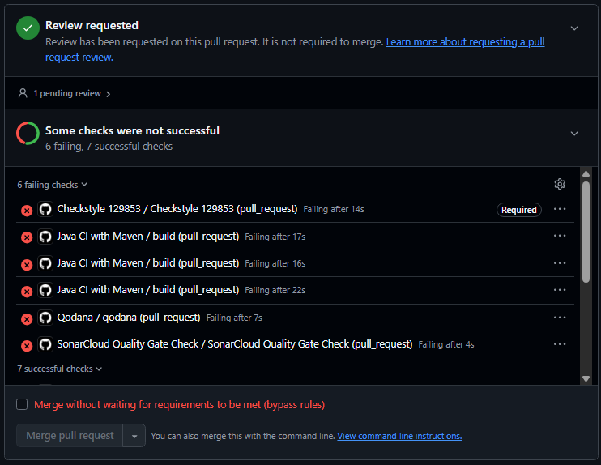

# Qodana: 129853 - Daniel

## Cheiro escolhido
Long Method (Brain Method no livro *Object-Oriented Metrics in Practice*, p. 92-93).

## Tabela de mapeamento

| Cheiro (Fowler) | Inspeção no IDE | ID da inspeção | Métrica / limiar | Limitações |
|---|---|---|---|---|
| Long Method | Overly long method | `NonCommentSourceStatements` | Instruções por método, `m_limit` = 25 | Conta instruções e não linhas (o livro usa LOC > 65) |
| Long Method | Overly complex method | `CyclomaticComplexity` | CYCLO, `m_limit` = 5 | Limiar absoluto, não relativo ao sistema |
| Long Method | Overly nested method | `NestingDepth` | Profundidade de aninhamento, `m_limit` = 3 | Sem NOAV (variáveis acedidas) no Qodana; não é possível exigir as condições em simultâneo (AND) |

## Ficheiros
- Workflow: `.github/workflows/qodana-smell-129853.yaml`
- Configuração: `qodana-129853.yaml`
- Perfil de inspeção: `.qodana/profiles/profile-129853.yaml`

## Execuções do quality gate
- Gate a falhar (cheiro provocado): https://github.com/LEI-129853/Battleship2/actions/runs/42525313838/job/128867537033?pr=21
- Gate a passar (depois de corrigir): https://github.com/LEI-129853/Battleship2/actions/runs/42526288423/job/128870532464?pr=21

## Proteção do ramo `main`
Ruleset `protect-main` no ramo `main`: exige PR e os 6 checks (`Qodana smell gate 129853/129820/129851` e `Checkstyle 129853/129820/129851`).
No PR #24 (https://github.com/LEI-129853/Battleship2/pull/24) o `Checkstyle 129853` falha e o merge fica bloqueado.

## Sensibilidade aos limiares

| Limiares (statements / CC / nesting) | `severityThresholds.any` | Nº de problemas | Resultado |
|---|---|---|---|
| 25 / 5 / 3 | 0 | 29 | falha |

## Reflexão
O Qodana detetou corretamente o método com quatro níveis de `if` aninhados (`Overly nested method`) e o gate falhou com `any: 0`; depois de refatorar o método passou. Em `main` a análise completa encontrou 29 problemas (18 de complexidade, 6 de tamanho e 5 de aninhamento), ou seja, o código existente já ultrapassa os limiares. Nos PRs só é analisado o código alterado, por isso um PR sem código novo falha com `Nothing to analyse` (falso negativo do processo, não do código). Os limiares são absolutos (25 instruções, CC 5, aninhamento 3) e não relativos ao sistema como no livro, e o Qodana não mede NOAV nem permite exigir as condições em simultâneo (AND), pelo que a estratégia do Brain Method só é aproximada.

## Alteração posterior (ficha 4)
- **Exclusão dos testes:** na parte 1 da ficha 4 (testes unitários), o gate passou a excluir `src/test`
  (`exclude` no `qodana-129853.yaml`). O enunciado da ficha 4 exige um teste por caminho de execução, o que faz
  as classes de teste ultrapassarem os limites dos cheiros (falsos positivos em código de teste).
  O perfil de inspeção e os valores-limite não foram alterados.
- **Efeito nas refabricações (parte 2):** em PR, o Qodana compara as versões antes e depois dos ficheiros
  alterados e só acusa problemas novos ou alterados. O gate bloqueou os PRs de refabricação que mexeram em `Move::processEnemyFire` e em `Tasks::menu` (métodos longos e complexos já existentes). Foram por isso aplicadas refabricações adicionais (Replace Method with Method Object: classes internas `ShotReport` e `GameMenu`, e Extract Method) até todos os métodos alterados ficarem dentro dos limites (CC 5, 25 instruções, aninhamento 3), e o gate passou.
